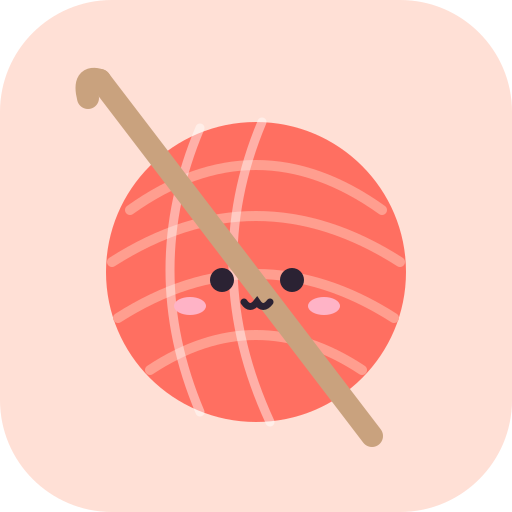
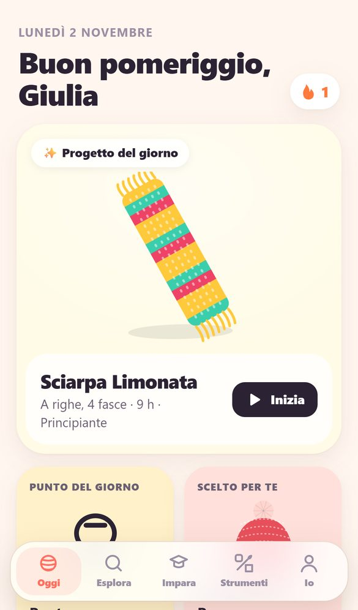
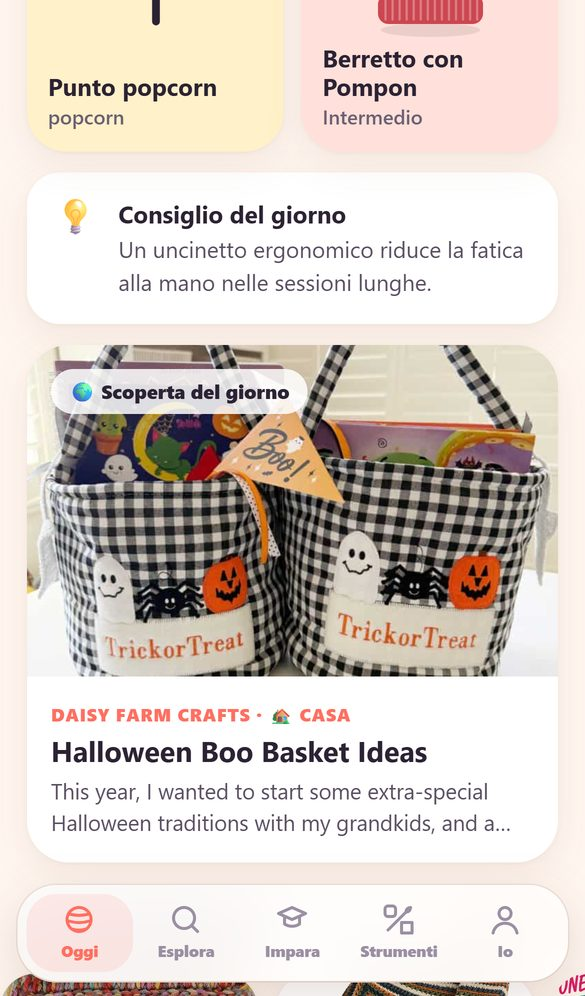
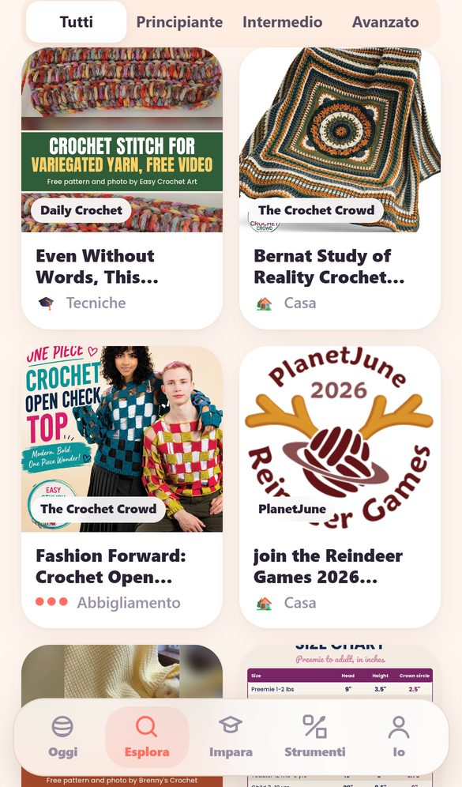
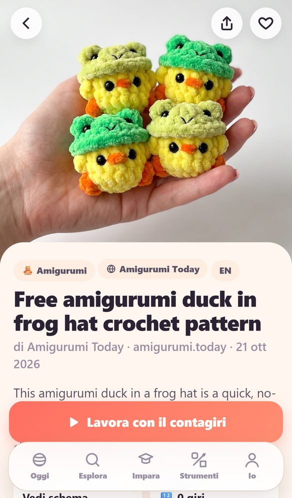
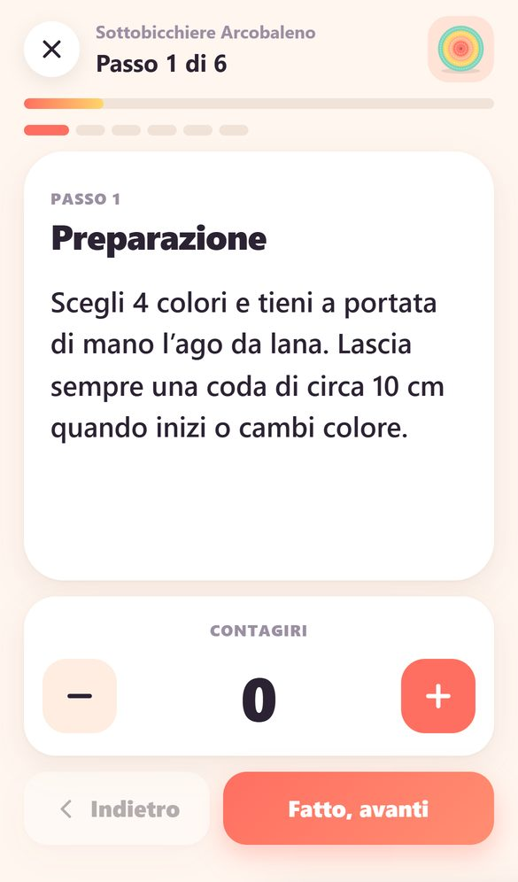
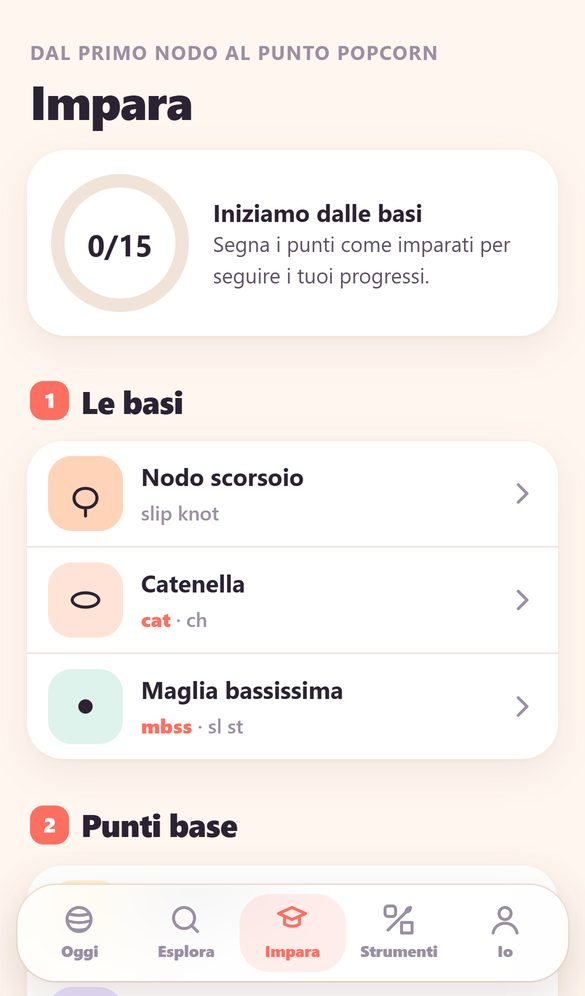
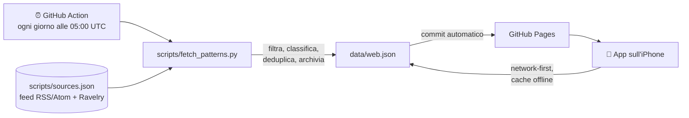

<div align="center">



# Gomitolo

**Impara l'uncinetto, un punto alla volta.**

Una Progressive Web App per iPhone dedicata al crochet. Contiene lezioni passo passo, un progetto nuovo ogni giorno, centinaia di schemi gratuiti raccolti dal web e tutti gli strumenti che servono mentre lavori.

[](https://github.com/DaValz/Gomitolo/actions/workflows/update-patterns.yml)


[**Apri l'app →**](https://DaValz.github.io/Gomitolo/)

🇬🇧 [English](README.md) · 🇮🇹 **Italiano**

</div>

---

## Screenshot

<table>
  <tr>
    <td align="center"><br><sub><b>Oggi</b><br>Progetto e punto del giorno</sub></td>
    <td align="center"><br><sub><b>Dal web</b><br>Scoperta del giorno</sub></td>
    <td align="center"><br><sub><b>Esplora</b><br>Ricerca e filtri</sub></td>
  </tr>
  <tr>
    <td align="center"><br><sub><b>Schema dal web</b><br>Anteprima e link all'originale</sub></td>
    <td align="center"><br><sub><b>Modalità lavoro</b><br>Passo passo con contagiri</sub></td>
    <td align="center"><br><sub><b>Impara</b><br>Percorso dei punti</sub></td>
  </tr>
</table>

## Indice

- [Funzionalità](#funzionalità)
- [Come funziona](#come-funziona)
- [Struttura del progetto](#struttura-del-progetto)
- [Avvio in locale](#avvio-in-locale)
- [Pubblicazione su GitHub Pages](#pubblicazione-su-github-pages)
- [Aggiornamento automatico degli schemi](#aggiornamento-automatico-degli-schemi)
- [Aggiungere nuove fonti](#aggiungere-nuove-fonti)
- [Contenuti e diritti d'autore](#contenuti-e-diritti-dautore)
- [Privacy](#privacy)
- [Roadmap](#roadmap)
- [Licenza](#licenza)

## Funzionalità

### 🧶 Progetti Gomitolo
- **Catalogo curato** di progetti in italiano: amigurumi, casa, accessori, abbigliamento e decorazioni. Ognuno ha materiali, punti, tempi e uno schema completo.
- **Progetto del giorno**: ogni giorno un generatore deterministico crea uno schema nuovo (mandala, granny square, sciarpe, amigurumi). È uguale per tutti e funziona offline.
- **Generatore di progetti**: crea in un tocco uno schema mai visto.
- **Modalità lavoro immersiva**: un passo alla volta, si scorre con lo swipe. Include un contagiri per ogni passo, obiettivi di giri e lo schermo che resta acceso (Wake Lock).
- **Abbreviazioni interattive**: tocca `mb`, `ma` o `aum` nello schema e appare la spiegazione del punto.

### 🌍 Schemi dal web
- **Centinaia di schemi gratuiti** da oltre 20 blog e siti di crochet internazionali, aggiornati ogni giorno in automatico.
- **Classificazione automatica** per categoria (amigurumi, casa, accessori, abbigliamento, decorazioni, tecniche), livello e tag (granny, C2C, tunisino, mosaico, Natale, avanzi di filo…).
- **Scoperta del giorno** in home e un carosello con le ultime novità.
- **Ricerca bilingue**: puoi cercare in italiano ("borsa", "coperta", "orsetto") e trovi anche gli schemi in inglese.
- **Contagiri e note** per ogni schema esterno: apri l'originale in una scheda accanto e tieni il conto in Gomitolo.
- **Cerca altrove**: scorciatoie verso Ravelry, YouTube, Google e Pinterest.

### 🎓 Impara
- **Percorso didattico** dal nodo scorsoio al punto popcorn, con simboli internazionali e istruzioni passo passo.
- **Glossario IT · USA · UK**, indispensabile per leggere gli schemi in inglese.
- Progressi, traguardi e giorni consecutivi.

### 🧰 Strumenti
- Contagiri multipli con nome.
- Convertitore delle misure degli uncinetti (mm / US / UK) e tabella dei filati.
- Calcolatore del campione.

### 📱 Esperienza app
- Installabile su iPhone dalla schermata Home, a schermo intero e con supporto alla safe area.
- Funziona offline grazie al service worker.
- Tema chiaro e scuro automatico.
- **Italiano e inglese**: la lingua segue quella del dispositivo e si cambia da **Io → Impostazioni → Lingua**.
- Nessun account: tutto resta sul dispositivo.

## Come funziona

GitHub Pages ospita solo file statici e il browser non può leggere direttamente altri siti per via del CORS. Per questo la raccolta degli schemi avviene **lato server, una volta al giorno**, con una GitHub Action:



1. **`fetch_patterns.py`** legge i feed RSS/Atom elencati in `sources.json` (e, se configurata, la Ravelry API).
2. Scarta i post che non sono schemi (recensioni, novità sui filati, post solo maglia…). Poi assegna categoria, livello e tag, e recupera l'immagine dal feed o dall'`og:image` della pagina.
3. I risultati si **uniscono all'archivio esistente**: gli schemi già visti restano, i duplicati vengono eliminati e l'archivio arriva al massimo a 900 voci.
4. L'Action fa il commit di `data/web.json` solo se è cambiato. GitHub Pages pubblica il nuovo file.
5. L'app scarica `data/web.json` all'avvio con una strategia **network-first** e usa la copia in cache quando sei offline.

Lo script usa solo la libreria standard di Python, senza dipendenze da installare.

## Struttura del progetto

```
gomitolo/
├── index.html                 # shell dell'app e tab bar
├── styles.css                 # design system, tema chiaro/scuro
├── app.js                     # router, pagine, stato, azioni
├── data.js                    # catalogo, punti, glossario, generatori giornalieri (IT)
├── data.en.js                 # gli stessi contenuti in inglese, con terminologia US
├── art.js                     # illustrazioni SVG generative e simboli dei punti
├── sw.js                      # service worker (offline + aggiornamenti)
├── manifest.webmanifest       # metadati PWA
├── icons/                     # icone app e apple-touch-icon
├── data/
│   └── web.json               # schemi dal web (generato dall'Action)
├── scripts/
│   ├── fetch_patterns.py      # aggregatore degli schemi
│   └── sources.json           # elenco delle fonti
├── docs/screenshots/          # immagini del README
└── .github/workflows/
    └── update-patterns.yml    # aggiornamento giornaliero
```

L'app non ha **build, bundler o framework**: HTML, CSS e JavaScript puro, serviti così come sono.

## Avvio in locale

Serve un qualsiasi server statico. Il service worker non funziona aprendo direttamente `index.html` con `file://`.

```bash
git clone https://github.com/GBS10540/gomitolo.git
cd gomitolo
python -m http.server 8000
# apri http://localhost:8000
```

Per rigenerare gli schemi dal web (richiede Python 3.10 o superiore):

```bash
python scripts/fetch_patterns.py
# opzionale: percorso di output diverso
python scripts/fetch_patterns.py --out /tmp/web.json
```

## Pubblicazione su GitHub Pages

1. Crea un repository (ad esempio `gomitolo`) e carica tutti i file, inclusi `.nojekyll` e la cartella `.github/`.
2. Vai su **Settings → Pages** e scegli *Deploy from a branch*, branch `main`, cartella `/ (root)`.
3. Dopo qualche minuto l'app è online su `https://<utente>.github.io/gomitolo/`.

**Installazione su iPhone:** apri il link in Safari, tocca **Condividi** e poi **Aggiungi alla schermata Home**.

> Se scegli un nome diverso per il repository o pubblichi da un altro account, aggiorna i link e i badge in cima a questo README.

## Aggiornamento automatico degli schemi

Il workflow [`update-patterns.yml`](.github/workflows/update-patterns.yml) parte **ogni giorno alle 05:00 UTC** e si può avviare anche a mano da **Actions → Aggiorna schemi dal web → Run workflow**.

Perché l'Action possa fare il commit di `data/web.json`:

- **Settings → Actions → General → Workflow permissions** e seleziona **Read and write permissions**.

### Ravelry (opzionale)

Puoi aggiungere i risultati di [Ravelry](https://www.ravelry.com), cioè gli schemi gratuiti all'uncinetto più popolari, con credenziali API in sola lettura:

1. Crea un'app *Basic Auth (read only)* su [ravelry.com/pro/developer](https://www.ravelry.com/pro/developer).
2. Nel repository, in **Settings → Secrets and variables → Actions**, aggiungi `RAVELRY_USER` e `RAVELRY_KEY`.

Le ricerche eseguite sono definite in `sources.json → ravelry.queries`. Senza secret, Ravelry viene semplicemente saltato.

## Aggiungere nuove fonti

Aggiungi una voce in [`scripts/sources.json`](scripts/sources.json):

```json
{ "name": "Nome del sito", "url": "https://esempio.com/feed/", "crochetOnly": true }
```

| Campo         | Descrizione |
|---------------|-------------|
| `name`        | Nome mostrato nell'app come fonte. |
| `url`         | Feed RSS o Atom. Per i siti WordPress di solito è `/feed/`, oppure `/category/crochet/feed/` per una sola categoria. |
| `crochetOnly` | `true` se il sito pubblica solo uncinetto. Con `false` vengono tenuti solo i post che parlano esplicitamente di crochet, amigurumi o granny. |
| `cat`         | *(opzionale)* forza una categoria, per esempio `"amigurumi"` per un sito dedicato. |

Lancia lo script in locale per verificare che la fonte restituisca risultati. Nel campo `sources` di `data/web.json` trovi il numero di schemi trovati e gli eventuali errori per ogni fonte.

## Contenuti e diritti d'autore

Gomitolo **non copia gli schemi**. Per ogni schema esterno mostra solo i metadati pubblicati nel feed del sito (titolo, immagine di anteprima, autore, data e un breve estratto) e rimanda sempre all'**articolo originale**, dove si trovano le istruzioni complete.

Tutti i diritti su testi, foto e schemi restano ai rispettivi autori. Se sei autore di uno dei siti e preferisci non comparire, apri una issue e la fonte verrà rimossa.

I progetti del catalogo Gomitolo e quelli generati ogni giorno sono originali e rilasciati con la licenza del progetto.

## Privacy

- Nessun account, cookie di tracciamento o analytics.
- Progressi, preferiti, contatori e note sono salvati solo nel `localStorage` del dispositivo. Puoi cancellarli da **Io → Azzera tutti i dati**.
- Le immagini di anteprima vengono caricate dai siti originali con `referrerpolicy="no-referrer"`.

## Roadmap

- [ ] Traduzione automatica dei titoli e degli estratti in italiano
- [ ] Più fonti in lingua italiana
- [ ] Esportazione e importazione dei progressi
- [ ] Diagrammi a simboli per i progetti del catalogo
- [ ] Promemoria giornaliero con le notifiche Web Push (iOS 16.4+)

## Licenza

Il codice è distribuito con licenza [MIT](LICENSE). Gli schemi esterni restano proprietà dei rispettivi autori (vedi [Contenuti e diritti d'autore](#contenuti-e-diritti-dautore)).

<div align="center"><sub>Fatto con ♥ e tanto filo.</sub></div>
