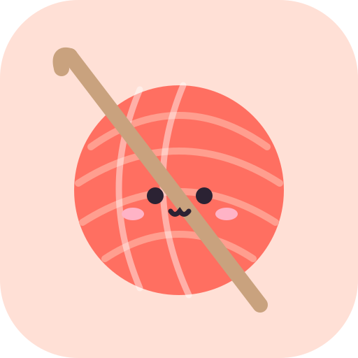
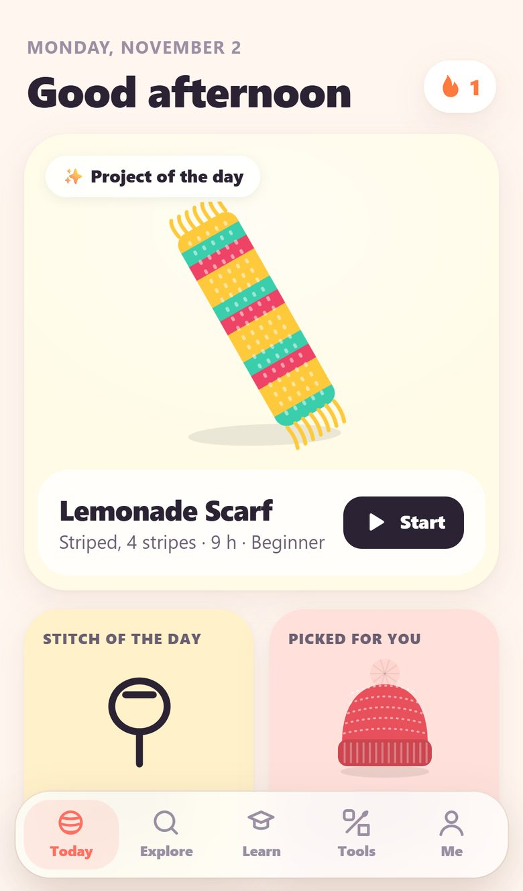
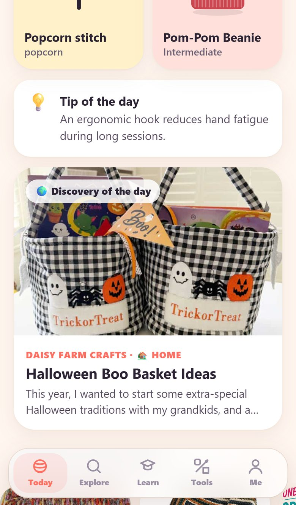
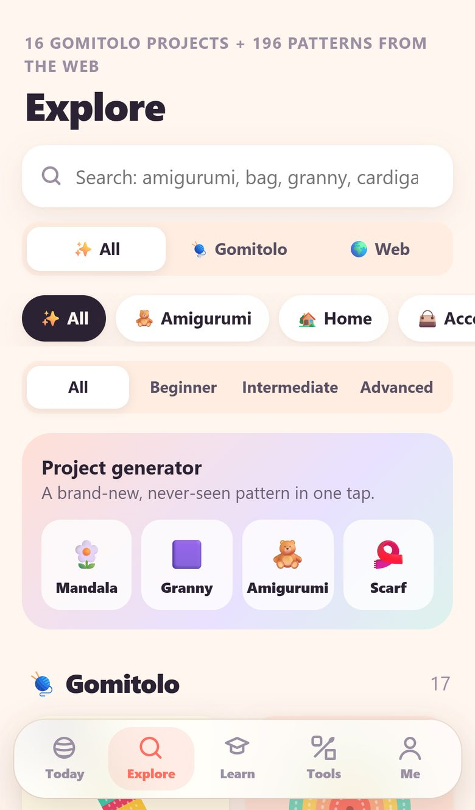
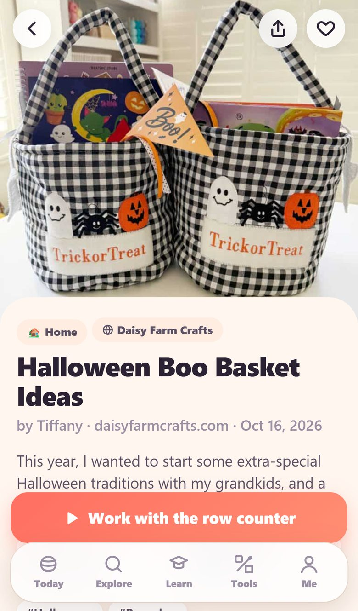
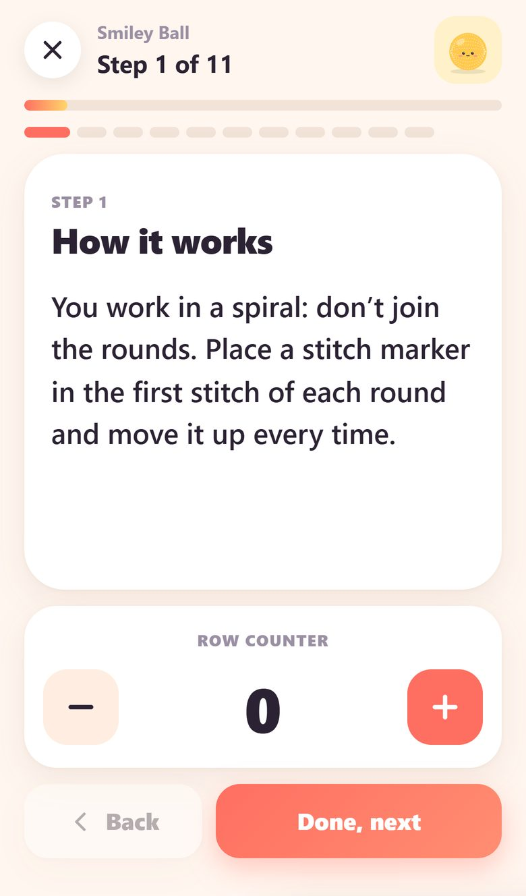
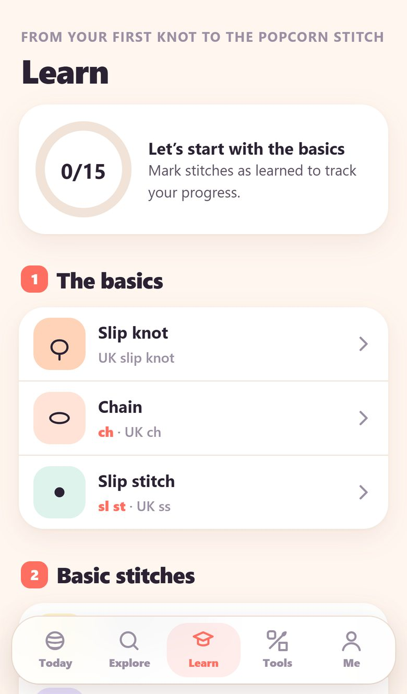
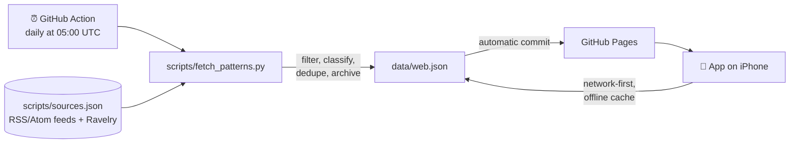

<div align="center">



# Gomitolo

**Learn to crochet, one stitch at a time.**

A Progressive Web App for iPhone dedicated to crochet. It has step-by-step lessons, a new project every day, hundreds of free patterns collected from around the web and all the tools you need while you hook.

[](https://github.com/DaValz/Gomitolo/actions/workflows/update-patterns.yml)


[**Open the app →**](https://DaValz.github.io/Gomitolo/)

🇬🇧 **English** · 🇮🇹 [Italiano](README.it.md)

</div>

---

## Screenshots

<table>
  <tr>
    <td align="center"><br><sub><b>Today</b><br>Project and stitch of the day</sub></td>
    <td align="center"><br><sub><b>From the web</b><br>Discovery of the day</sub></td>
    <td align="center"><br><sub><b>Explore</b><br>Search and filters</sub></td>
  </tr>
  <tr>
    <td align="center"><br><sub><b>Web pattern</b><br>Preview and link to the original</sub></td>
    <td align="center"><br><sub><b>Work mode</b><br>Step by step with row counter</sub></td>
    <td align="center"><br><sub><b>Learn</b><br>Stitch learning path</sub></td>
  </tr>
</table>

## Table of contents

- [Features](#features)
- [How it works](#how-it-works)
- [Project structure](#project-structure)
- [Running locally](#running-locally)
- [Deploying to GitHub Pages](#deploying-to-github-pages)
- [Automatic pattern updates](#automatic-pattern-updates)
- [Adding new sources](#adding-new-sources)
- [Localization](#localization)
- [Content and copyright](#content-and-copyright)
- [Privacy](#privacy)
- [Roadmap](#roadmap)
- [License](#license)

## Features

### 🧶 Gomitolo projects
- **Curated catalog** of projects: amigurumi, home, accessories, clothing and decor. Each one lists materials, stitches, time and a complete pattern.
- **Project of the day**: every day a deterministic generator creates a new pattern (mandala, granny square, scarf, amigurumi). Everyone gets the same one, and it works offline.
- **Project generator**: get a brand-new pattern in one tap.
- **Immersive work mode**: one step at a time, with swipe navigation. It includes a row counter for each step, row goals, and keeps the screen awake (Wake Lock API).
- **Interactive abbreviations**: tap `sc`, `dc` or `inc` in a pattern to see how the stitch is made.

### 🌍 Patterns from the web
- **Hundreds of free patterns** from more than 20 crochet blogs and sites, updated automatically every day.
- **Automatic classification** by category (amigurumi, home, accessories, clothing, decor, techniques), skill level and tags (granny, C2C, Tunisian, mosaic, Christmas, scrap yarn…).
- **Discovery of the day** on the home screen, plus a carousel of the latest additions.
- **Bilingual search**: Italian keywords ("borsa", "coperta", "orsetto") also match English patterns.
- **Row counter and notes** for every external pattern. Open the original in another tab and keep count in Gomitolo.
- **Search elsewhere**: shortcuts to Ravelry, YouTube, Google and Pinterest.

### 🎓 Learn
- **Learning path** from the slip knot to the popcorn stitch, with international symbols and step-by-step instructions.
- **US · UK · Italian glossary**, essential for reading patterns from different countries.
- Progress tracking, achievements and daily streaks.

### 🧰 Tools
- Multiple named row counters.
- Hook size converter (mm / US / UK) and yarn weight chart.
- Gauge calculator.

### 📱 App experience
- Installable on iPhone from the Home Screen, full screen, with safe-area support.
- Works offline thanks to a service worker.
- Automatic light and dark theme.
- **English and Italian**: the app follows the device language and can be switched under **Me → Settings → Language**.
- No account needed: everything stays on your device.

## How it works

GitHub Pages only serves static files, and CORS prevents the browser from reading other sites directly. Pattern collection therefore happens **server-side, once a day**, in a GitHub Action:



1. **`fetch_patterns.py`** reads the RSS/Atom feeds listed in `sources.json`, plus the Ravelry API if it is configured.
2. It drops posts that aren't patterns (reviews, yarn news, knitting-only posts…). It then assigns a category, level and tags, and takes the image from the feed or from the page's `og:image`.
3. Results are **merged into the existing archive**: patterns already seen are kept, duplicates are removed, and the archive is capped at 900 entries.
4. The Action commits `data/web.json` only when it has changed, and GitHub Pages publishes the new file.
5. The app downloads `data/web.json` on launch using a **network-first** strategy, and falls back to the cached copy when you're offline.

The script uses only the Python standard library, so there are no dependencies to install.

## Project structure

```
gomitolo/
├── index.html                 # app shell, tab bar and language loader
├── styles.css                 # design system, light/dark theme
├── app.js                     # router, pages, state, actions, UI strings (IT/EN)
├── data.js                    # catalog, stitches, glossary, daily generators (Italian)
├── data.en.js                 # the same content in English, with US crochet terms
├── art.js                     # generative SVG illustrations and stitch symbols
├── sw.js                      # service worker (offline + updates)
├── manifest.webmanifest       # PWA metadata
├── icons/                     # app icons and apple-touch-icon
├── data/
│   └── web.json               # web patterns (generated by the Action)
├── scripts/
│   ├── fetch_patterns.py      # pattern aggregator
│   └── sources.json           # list of sources
├── docs/screenshots/          # README images (en/ and it)
└── .github/workflows/
    └── update-patterns.yml    # daily update
```

The app has **no build step, bundler or framework**: plain HTML, CSS and JavaScript, served as is.

## Running locally

Any static server works. The service worker won't run if you open `index.html` directly via `file://`.

```bash
git clone https://github.com/GBS10540/gomitolo.git
cd gomitolo
python -m http.server 8000
# open http://localhost:8000
```

To regenerate the web patterns (requires Python 3.10 or later):

```bash
python scripts/fetch_patterns.py
# optional: custom output path
python scripts/fetch_patterns.py --out /tmp/web.json
```

## Deploying to GitHub Pages

1. Create a repository (for example `gomitolo`) and upload all files, including `.nojekyll` and the `.github/` folder.
2. Go to **Settings → Pages** and choose *Deploy from a branch*, branch `main`, folder `/ (root)`.
3. After a few minutes the app is live at `https://<user>.github.io/gomitolo/`.

**Installing on iPhone:** open the link in Safari, tap **Share**, then **Add to Home Screen**.

> If you choose a different repository name or publish from another account, update the links and badges at the top of this README.

## Automatic pattern updates

The [`update-patterns.yml`](.github/workflows/update-patterns.yml) workflow runs **every day at 05:00 UTC**. You can also start it manually from **Actions → Aggiorna schemi dal web → Run workflow**.

The Action needs permission to commit `data/web.json`:

- Go to **Settings → Actions → General → Workflow permissions** and select **Read and write permissions**.

### Ravelry (optional)

You can add results from [Ravelry](https://www.ravelry.com), meaning the most popular free crochet patterns, using read-only API credentials:

1. Create a *Basic Auth (read only)* app at [ravelry.com/pro/developer](https://www.ravelry.com/pro/developer).
2. In the repository, under **Settings → Secrets and variables → Actions**, add `RAVELRY_USER` and `RAVELRY_KEY`.

The searches to run are defined in `sources.json → ravelry.queries`. Without the secrets, Ravelry is simply skipped.

## Adding new sources

Add an entry to [`scripts/sources.json`](scripts/sources.json):

```json
{ "name": "Site name", "url": "https://example.com/feed/", "crochetOnly": true }
```

| Field         | Description |
|---------------|-------------|
| `name`        | Name shown in the app as the source. |
| `url`         | RSS or Atom feed. For WordPress sites this is usually `/feed/`, or `/category/crochet/feed/` for a single category. |
| `crochetOnly` | `true` if the site publishes only crochet. With `false`, only posts that explicitly mention crochet, amigurumi or granny are kept. |
| `cat`         | *(optional)* force a category, for example `"amigurumi"` for a dedicated site. |

Run the script locally to check that the source returns results. The `sources` field in `data/web.json` shows how many patterns were found for each source and any errors.

## Localization

The app is available in **English** and **Italian**:

- On first launch, the language follows the device: Italian if the system language is Italian, English otherwise. You can change it under **Me → Settings → Language**. The choice is stored in `localStorage` (`gomitolo-lang`).
- `index.html` loads either `data.js` (Italian) or `data.en.js` (English). Both files expose the same `window.GOMITOLO` structure with identical IDs, so progress, favorites and counters carry over when you switch language.
- English content uses **US crochet terminology** (`sc`, `hdc`, `dc`…). The glossary and stitch pages also show the UK and Italian equivalents.
- Interface strings live in `app.js` and use the helper `L('italiano', 'English')`.

To add another language, create a `data.<lang>.js` with the same structure, extend the loader in `index.html`, and add the extra string to the `L()` helper.

## Content and copyright

Gomitolo **does not copy patterns**. For every external pattern it shows only the metadata the site publishes in its feed (title, preview image, author, date and a short excerpt), and always links to the **original article**, where the full instructions are.

All rights to text, photos and patterns remain with their respective authors. If you run one of the sites and would rather not be listed, open an issue and the source will be removed.

The projects in the Gomitolo catalog and the daily generated ones are original and released under the project license.

## Privacy

- No accounts, tracking cookies or analytics.
- Progress, favorites, counters and notes are stored only in the device's `localStorage`. You can erase them under **Me → Reset all data**.
- Preview images are loaded from the original sites with `referrerpolicy="no-referrer"`.

## Roadmap

- [ ] Automatic translation of web pattern titles and excerpts
- [ ] More Italian-language sources
- [ ] Export and import of progress
- [ ] Symbol charts for catalog projects
- [ ] Daily reminder via Web Push notifications (iOS 16.4+)

## License

The code is released under the [MIT](LICENSE) license. External patterns remain the property of their respective authors (see [Content and copyright](#content-and-copyright)).

<div align="center"><sub>Made with ♥ and lots of yarn.</sub></div>
